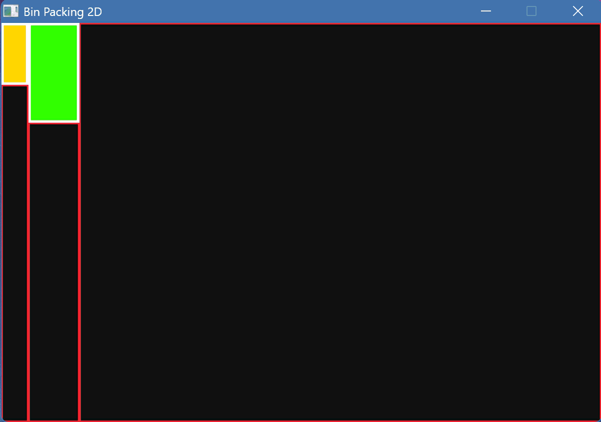

# Algorithms Playground

## Purpose

This Repo is meant for use as a playground for testing different kinds of algorithms.

## [Bin Packing 2D](bin-packing-2D/main.c)



### Problem

Suppose you have a list of rectangles $\{R_1,R_2,R_3,..,R_n\}$ and a huge recatngle $R$ with dimensions $R_w, R_h$.
You need to find a way of inserting all rectangles $\{R_1,R_2,R_3,..,R_n\}$ into $R$ witout overlaps.

The advance one is an online problem, The list $\{R_1,R_2,R_3,..,R_n\}$ is not known and you need to create some kind of data structure to handle add and remove rectangles int $R$. While wasting as little area as possible...

This problem is NP-Hard and I am not trying to solve it deterministically but i want a good approximation.

### My Solution

It's not really mine i read it somewhere and i can't remember where...

So we keep a tree of nodes and we do  as follows:

At start we have an empty rectangle with dimensions $R_w, R_h$.

Now, suppose the first rectangle ($R_1$) with dimensions $w_1,h_1$ and suppose that $$w_1 < R_w \text{ and } h_1 < R_h$$

Now, imagine we put the smaller rectangle at the top left of the big one.
```
             w_1                 R_w - w_1
      <-------------><---------------------------->
      +--------------+----------------------------+
      |              |                            |
      |              |                            |
 h_1  |              |                            |
      |              |                            |
      +--------------+                            |
      |                                           |
      |                                           | R_h - h_1
      |                                           |
      |                                           |
      +-------------------------------------------+
      ^
      |
      R_h
```
We can devide the bigger into two smaller rectangles and solve the next one recursivly.

We have two options:
```
    Option 1:
             w_1                 R_w - w_1
      <-------------><---------------------------->
      +--------------+----------------------------+
      |              |                            |
      |              |             LEFT           |
 h_1  |              |                            |
      |              |                            |
      +--------------+----------------------------|
      |                                           |
      |                BOTTOM                     | R_h - h_1
      |                                           |
      |                                           |
      +-------------------------------------------+
      ^
      |
      R_h
    Option 2:
             w_1                 R_w - w_1
      <-------------><---------------------------->
      +--------------+----------------------------+
      |              |                            |
      |              |             LEFT           |
 h_1  |              |                            |
      |              |                            |
      +--------------+                            |
      |              |                            |
      |     BOTTOM   |                            | R_h - h_1
      |              |                            |
      |              |                            |
      +-------------------------------------------+
      ^
      |
      R_h
```

What do we choose? So we dont have any way of really deciding the best choice without knowing the future input rectangles.

But i chose huristic that prefer to convarge into a square...

Thus we choose the seperation that is the closest to squares (In the example this is the second one).

The way i check which one is better is using the following:
$$ \left|\frac{BOTTOM_w}{BOTTOM_h} - 1\right| + \left|\frac{LEFT_w}{LEFT_h} - 1\right|$$

The option in which this expression is the smallest is the one i choose.