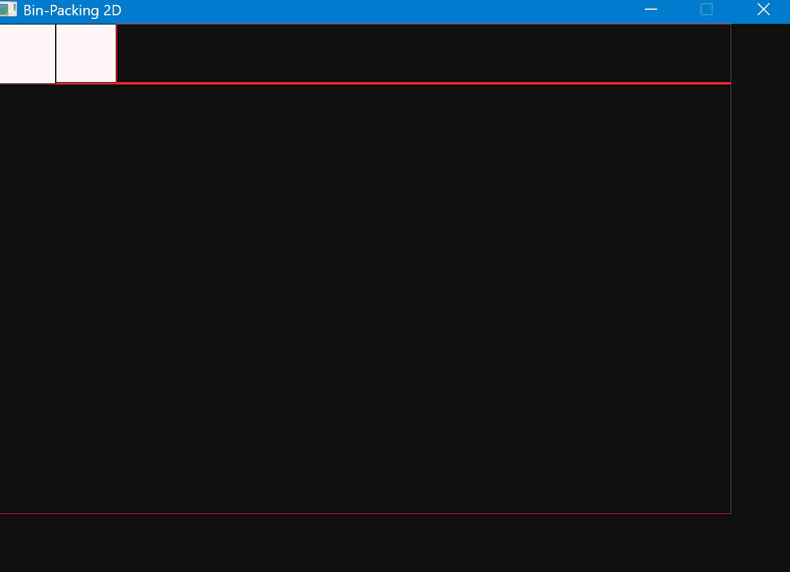
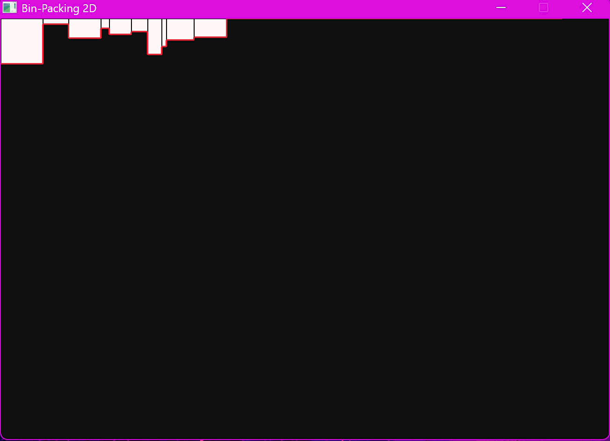

# Algorithms Playground

## Purpose

This Repo is meant for use as a playground for testing different kinds of algorithms.

## [Bin Packing 2D](bin-packing-2D/main.c)

## Guillotine approach (Offline-Sorted)


## Skyline approach (online-Unsorted)


### Problem

Suppose you have a list of rectangles $\{R_1,R_2,R_3,..,R_n\}$ and a huge recatngle $R$ with dimensions $R_w, R_h$.
You need to find a way of inserting all rectangles $\{R_1,R_2,R_3,..,R_n\}$ into $R$ witout overlaps.

The advance one is an online problem, The list $\{R_1,R_2,R_3,..,R_n\}$ is not known and you need to create some kind of data structure to handle add and remove rectangles int $R$. While wasting as little area as possible...

This problem is NP-Hard and I am not trying to solve it deterministically but i want a good approximation.

### Solution 1 The Guillotine algorithm

You can check out the [wikipidia](https://en.wikipedia.org/wiki/Guillotine_cutting) about it.

### Solution 2 The Skyline algorithm

I could not find a good & simple resource online for that but it is easy to understand you just drop the rectangle on the skyline and find the place where if it falls it will minimize the height increament.

## Quick Start

**Important** Make sure gcc is set as environment variable & [Here](bin-packing-2D/build.cmd) change the 
```batch
set raylib_path=C:/raylib/raylib/src
```
to the correct path.

Then you can run
*Debug build*
```powershell
.\bin-packing-2D\build.cmd d
.\bin\bin-packing-dbg.exe

```
*Release build*
```powershell
.\bin-packing-2D\build.cmd r
.\bin\bin-packing-rel.exe
```
